<p align="center">
  
</p>

<h1 align="center">NookClip</h1>

<p align="center">
  <strong>A lightweight, fast, and privacy-first clipboard manager.</strong>
</p>

<p align="center">
  <a href="https://lx3xun.github.io/nook-clip/">Product Page</a> · <a href="README.md">简体中文</a> · <a href="README.zh-TW.md">繁體中文</a> · <a href="README.en.md">English</a>
</p>

<p align="center">
  <a href="https://lx3xun.github.io/nook-clip/"></a>&nbsp;<a href="https://www.apple.com/macos/"></a>&nbsp;<a href="https://swift.org"></a>&nbsp;<a href="https://www.rust-lang.org"></a>&nbsp;<a href="LICENSE"></a>
</p>

## 💡 What Problems Does It Solve?

Default clipboard behavior often brings familiar friction:

- **Overwritten accidentally**: Copying a new sentence or link replaces your previous snippet immediately, forcing you to switch back and find it again.
- **Cluttered history that is hard to search**: Many tools only allow paging through items chronologically, or have sluggish search that misses shortcuts and image text.
- **Privacy risks**: Clipboards regularly contain passwords, API keys, and connection strings. Many utilities send telemetry, require accounts, or upload history to third-party clouds.
- **Heavy resource usage**: Background tools often consume hundreds of megabytes of RAM and stutter when summoned.

**NookClip is built to solve these issues cleanly:**

It uses a native interface backed by a high-performance Rust core, keeping memory usage around 20 MB with instant response. Most importantly: **no accounts, no telemetry, no crash tracking — all data stays completely on your local device**.

| Light Mode | Dark Mode |
| :---: | :---: |
|  |  |

---

## Features

### Clipboard History & Fast Search
- **Global Hotkey**: Press `⌘ ⇧ V` to summon the panel anywhere; it closes automatically on focus loss or `Esc`.
- **Type-to-Search**: Start typing immediately when the panel opens—no need to click into the search field first.
- **Quick App Launch**: Type app names or initials (e.g. `wx`, `terminal`) directly in the search bar and press Enter to launch.
- **Full-Text & OCR Search**: Built on SQLite FTS5 to search through text and URLs; screenshots become searchable once you tap Recognize Text on their card, with matches highlighted.
- **Type & Tag Filtering**: Focus the search field to expand the filter panel—eight fixed type slots (Favorites / Images / Text / Links / Code / Files / Colors / Trash) keep stable positions, with a tag flow below for combining tag filters on top of a type.

### Content Recognition & Preview
- **Offline Image OCR**: Tap Recognize Text on an image card to run built-in on-device vision over the screenshot—no memory held until you ask—then search the indexed text or copy it with one click.
- **Syntax Highlighting & JSON Formatting**: Automatic code highlighting; JSON content can be formatted, minified, or copied with a single click.
- **QR Code for Links**: Generates QR codes directly from recognized URLs for quick mobile scanning.
- **Color Previews**: Recognizes hex color codes (e.g. `#FF5722`), showing color dots inline and providing one-click copy for HEX and RGB values.
- **Missing File Protection**: Warns before pasting if a copied file has been moved or deleted.

### Credential & Privacy Protection
- **Credential Detection**: Automatically identifies API keys, access tokens, private keys, and connection strings with passwords.
- **Encrypted Local Storage**: Sensitive entries are encrypted with AES-256-GCM before saving to disk; keys are stored locally and in the system keychain.
- **Privacy Masking**: Displays as `••••••••` in the list with automatic re-masking after 30 seconds.
- **Isolated from Search & Sync**: Sensitive entries are never written to search indexes or uploaded during sync.
- **App Blacklist**: Automatically pauses recording when password managers or other excluded apps are active in the foreground.
- **Semantic Redaction on Paste (`⌃ ⏎`)**: press `⌃ ⏎` and 19 categories of sensitive data — keys, phone numbers, IDs, bank cards, IBANs, emails, IPs, hostnames, home paths — become readable placeholders such as `<API_KEY_1>` and `<EMAIL_1>`, so you can hand "runnable but real-value-free" text to an AI or a colleague. Bank cards use Luhn, national IDs use ISO 7064 and IBANs use MOD-97, leaving everyday text like `127.0.0.1` and `/Users/Shared` untouched.
- **One-Key Restore (`⌃ ⇧ ⏎`)**: when an AI reply brings placeholders back, the preview pane shows "N redaction placeholders detected" — press `⌃ ⇧ ⏎` to restore the real values before pasting.
- **Hint Before Pasting**: selecting an item that contains keys, emails, card numbers or similar sensitive data shows a single line at the top of the preview pane — "N sensitive items found (email, API key)" — with a `⌃ ⏎` scrubbed-paste shortcut right there, so you no longer have to paste once to find out what you leaked. No dialog, no blocked keystrokes; switch it off in Settings → Privacy.
- **Mapping Table Never Touches Disk**: placeholder-to-value pairs live only in RAM, never in the database or logs; they expire after 30 minutes of inactivity and can be wiped from Settings at any time.

### More Capabilities
- **iCloud Drive Sync**: Optional sync across your own devices using your personal iCloud Drive (no third-party servers).
- **Backup & Export**: Export to JSON or Markdown, with options to exclude or mask sensitive items.
- **Batch Actions & Undo**: Select multiple items with Shift or ⌘ to merge-paste or delete; undo deletions within 10 seconds with `⌘ Z`.
- **Paste Stack (`⌥ ⏎`)**: select several items and press `⌥ ⏎` to queue them **in the order you copied them** (oldest first — deliberately the reverse of the "newest first" list order); a panel appears at the bottom of the screen listing every queued item with "x of y pasted" progress. Pressing native `⌘ V` repeatedly in the target app pastes them one by one, or click the "Paste" button on any row to paste that item right away. The row marked ▶ is "next up" and advances automatically to the next item not yet pasted; clicking a row only moves the highlight (press `⏎` to paste it), and pasted rows get a check and strikethrough. The panel can be dragged and remembers its position, and recording mode has its own global shortcut `⌃ ⌥ V` (press again to stop). The panel never steals focus, so `Esc` ends the queue from any app without clicking it first. While recording, each copy also sends a small card arcing from the pointer into the row it just landed in. While the queue is active the clipboard always holds the highlighted row, so copying something new never displaces items you have not pasted yet.
- **Pin to Screen (`⌘ P`)**: pin any item as a floating note (up to 12 at once) with adjustable opacity, collapse, click-through, inline editing, copy, or save back to history; image notes can copy their OCR text in one click.

---
## ⌨️ Keyboard Shortcuts

| Shortcut | Action |
| :--- | :--- |
| **`⌘ ⇧ V`** | Show / hide quick panel (re-recordable in **Settings → Paste**) |
| **`⌃ ⌥ V`** | Start / stop recording a Paste Stack (build a queue by copying from any app) |
| **`↑` / `↓`** | Move selection up or down (hold to repeat; auto-paginates at the bottom) |
| **`⇧ ↑` / `⇧ ↓` / `⌘ Click`** | Extend multi-selection (`⏎` to merge & paste, `⌘ ⌫` to bulk delete) |
| **`⏎`** | Paste selection into the frontmost app / Launch selected application |
| **`⌃ ⏎`** | Redacted paste: replace sensitive data with semantic placeholders (`<API_KEY_1>` etc.) |
| **`⌃ ⇧ ⏎`** | Restore-and-paste: swap placeholders on the clipboard back for their real values |
| **`⌘ P`** | Pin the selected item as a floating on-screen note |
| **`⌥ ⏎`** | Paste as plain text (strips fonts, colors, and rich formatting); starts Paste Stack in multi-select mode |
| **`⌘ ⏎`** | Paste and keep panel open (great for filling multi-field forms) |
| **`⌘ C`** | Re-copy selection to system clipboard (or copy selected text in preview) |
| **`⌘ [` / `⌘ ]`** | Cycle content types (`⌘ ]` next, `⌘ [` previous, empty types skipped) |
| **`⌘ ↓`** | Expand / collapse the filter panel under the search field (type grid + tag flow) |
| **`⌘ F`** | Focus the search field and expand the filter panel (or simply start typing while in list mode) |
| **`⌘ T`** | Cycle through time groups (or click the group title to jump via its menu) |
| **`⌘ S`** | Favorite / unfavorite item (favorites are exempt from item-count & disk-quota cleanup) |
| **`⌘ R`** | Set or clear a custom alias for the selected item |
| **`⌘ ⌫`** | Delete selected item(s) (undoable within 10 seconds) |
| **`⌘ Z`** | Undo last delete |
| **`⌘ L`** | Edit tags of the selected item |
| **`⌫`** | With the search field focused, remove embedded filter conditions one layer at a time (tag first, then type; deletes text normally when there is a query) |
| **`Esc`** | Layered dismiss: close tag/rename overlay → collapse filter panel → exit multi-select → clear search → clear tag → reset type filter → reset time group → hide panel |

---

## 📦 Download & Install

### Option 1: Prebuilt DMG Installer

Download the Universal DMG package directly (runs natively on both Apple Silicon `arm64` and Intel `x86_64`):

- **GitHub Releases (Latest)**: [Download from GitHub Releases](https://github.com/lx3xun/nook-clip/releases/latest)
- **Gitee Releases (Fast in China)**: [Visit Gitee Releases](https://gitee.com/lx3xun/nook-clip/releases)
- **All Releases**: [GitHub Releases](https://github.com/lx3xun/nook-clip/releases)

After downloading, open the `.dmg` image and drag **NookClip** into your **Applications** folder.

> **⚠️ First-Launch & Permission Notes (Ad-hoc Signed Open-Source Build)**
>
> Because this open-source project does not use a paid Apple Developer account for notarization, release binaries are ad-hoc signed and may trigger a macOS Gatekeeper prompt on first launch:
>
> 1. **“Cannot be opened because the developer cannot be verified”**: In Finder, **Control-click (or right-click)** `/Applications/NookClip.app`, choose **Open**, and click **Open** again in the dialog.
> 2. **“NookClip is damaged and can’t be opened”**: Run the following command in Terminal to strip the download quarantine attribute:
>    ```bash
>    xattr -cr /Applications/NookClip.app
>    ```
> 3. **Accessibility Permission (Required for Auto-Paste)**: Enable **NookClip** under **System Settings → Privacy & Security → Accessibility**. If direct paste stops working after an app update, select NookClip in the Accessibility list, click `[-]` to remove it, and re-add `[+]` it.

### Option 2: Build from Source (Recommended for Developers — No Gatekeeper Prompt)

```bash
git clone https://github.com/lx3xun/nook-clip.git
cd nook-clip
zsh scripts/build.sh app --universal   # produces dist/NookClip.app (arm64 + x86_64)
cp -R dist/NookClip.app /Applications/
```

**Requirements**:
- macOS 14.0 (Sonoma) or later
- Xcode 15+ or Swift 5.10+ Command Line Tools
- Rust 1.75+ toolchain (install both `aarch64-apple-darwin` and `x86_64-apple-darwin` targets when building `--universal`)

---

## Privacy & Data Security

NookClip follows a strict "local-first, zero tracking" policy:

1. **No Data Collection**: No accounts, no behavior tracking, no crash telemetry.
2. **Explicit Network Use**: Network requests only happen when checking for app updates (can be turned off in Settings) or when you explicitly enable iCloud Drive sync.
3. **Local Encryption for Secrets**: Identified passwords and API keys are encrypted at rest with AES-256-GCM, with keys managed locally and in the system keychain.
4. **Sensitive Data Isolation**: Sensitive entries are never written into search indexes and are never uploaded to iCloud.
5. **Transparent Local File Storage**:
   ```text
   ~/Library/Application Support/com.lx3xun.nookclip/
   ├── library.db       # SQLite database (history records and search indexes)
   ├── Content/         # Cached images and files
   └── .master_key      # Local master encryption key
   ```

---

## 🛠 Development

### Project Layout

```text
nook-clip/
├── crates/                        # Rust core workspace (cross-platform storage, FTS5 search, sync & crypto)
│   ├── nook-core/                 # Core engine (SQLite WAL + FTS5, AES-256-GCM, Zstd sync packs, redacted export)
│   └── nook-ffi/                  # UniFFI 0.28 bindings (generates Swift / C bridge & static library)
├── platform/macOS/                # Native macOS client (Swift Package)
│   ├── Package.swift              # SwiftPM manifest (Sparkle 2)
│   ├── Sources/NookClip/
│   │   ├── App/                   # App lifecycle, floating panel (DraggablePanel), global hotkeys & key routing
│   │   ├── Clipboard/             # Pasteboard monitor, paste service, sensitive detector, app exclusions & classifier
│   │   ├── CoreBridge/            # UniFFI-generated Swift bridge
│   │   ├── Crypto/                # 0600 master key file & Keychain service
│   │   ├── Localization/          # Instant runtime localization (en / zh-Hans / zh-Hant)
│   │   ├── Resources/             # Localized strings (Localizable.strings) & app icons
│   │   ├── Search/                # Installed app search (with Pinyin index), Vision offline OCR & query parser
│   │   ├── Storage/               # Rust store wrapper, iCloud Drive sync coordinator & item/disk cap cleanup
│   │   └── UI/                    # SwiftUI main panel, rich preview cards (Code/JSON/OCR/QR/Color) & Settings
│   ├── Tests/NookClipTests/       # Unit & integration test suite (isolated named pasteboards)
│   └── Packaging/                 # Info.plist and entitlements
├── scripts/                       # Unified build, packaging & release scripts (build.sh / build-app.sh / build-dmg.sh)
├── README.md                      # Simplified Chinese documentation
├── README.zh-TW.md                # Traditional Chinese documentation
└── README.en.md                   # English documentation
```

### Build Commands

```bash
# 1. Fast debug build for local development (skips Rust in 0s if unchanged)
zsh scripts/build.sh dev

# 2. Build incrementally and launch local NookClip.app
zsh scripts/build.sh run

# 3. Compile Rust core and regenerate UniFFI Swift bindings
zsh scripts/build.sh rust

# 4. Package production Universal .app and .dmg (with SHA256 checksum)
zsh scripts/build.sh app --universal
zsh scripts/build.sh dmg --universal

# 5. Clean build artifacts and caches
zsh scripts/build.sh clean
```

### Testing

All tests run against isolated temporary databases and private named pasteboards—**never touching your production database or system clipboard**:

```bash
# Run Rust core unit & integration tests
cargo test --workspace

# Run macOS Swift unit & integration tests
swift test --package-path platform/macOS

# Run large-scale performance benchmarks (5k / 10k / 50k items, skipped by default)
NOOK_PERF=1 swift test --package-path platform/macOS --filter PerformanceBenchmarkTests
```

### Contributing

Issues and Pull Requests are welcome! Please read [CONTRIBUTING.md](CONTRIBUTING.md) for commit conventions, 3-language localization rules, and test isolation guidelines. To report a security vulnerability, please follow [SECURITY.md](SECURITY.md) rather than opening a public issue.

---

## 📄 License & Trademark Notice

- **Open-Source License**: The source code in this repository is licensed under the [GNU General Public License v3.0 (GPLv3)](LICENSE). Any modified or derivative distributions must also disclose their full source code under GPLv3.
- **Commercial Distribution & App Store Exclusivity**: The original copyright holder (`lx3xun`) retains the exclusive right to distribute notarized binaries and proprietary commercial editions on the Apple App Store and official commercial channels. No third party may submit this software or its derivatives to the Apple App Store or other commercial app stores without prior written permission.
- **Trademark & Branding Protection**: Pursuant to Section 7(e) of the GPLv3, the **“NookClip”** name, app icons (`AppIcon.icns` / `NookClipIcon.svg`), and associated brand assets are the exclusive property of `lx3xun` and are not granted under this open-source license. Derivative works must remove all NookClip branding and logos before distribution.

[GPLv3](LICENSE) © 2026 lx3xun
