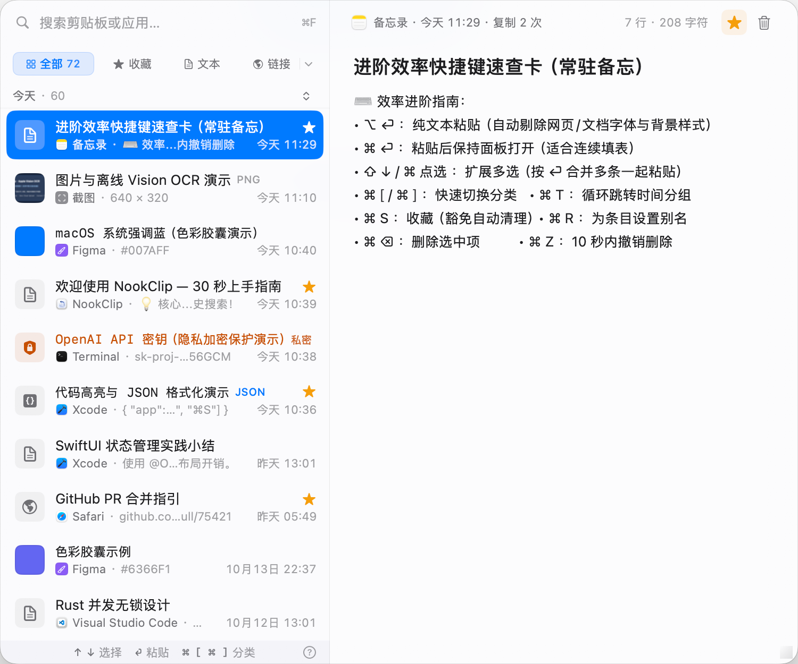
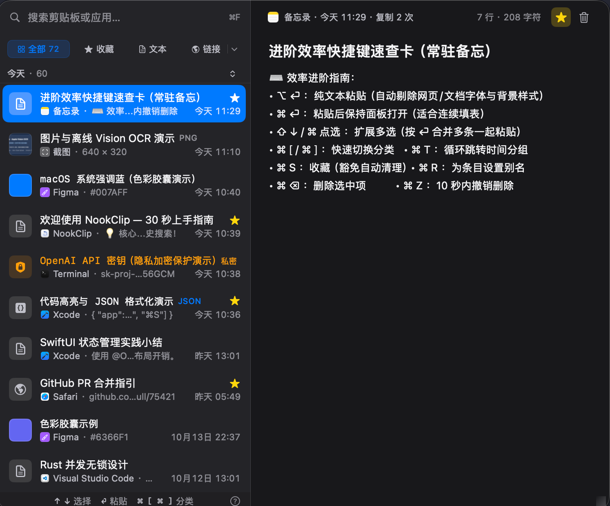

# NookClip

**輕量、快速、注重隱私的剪貼簿管理工具。**

[介紹頁](https://lx3xun.github.io/nook-clip/) · [简体中文](README.md) · [繁體中文](README.zh-TW.md) · [English](README.en.md)

[](https://lx3xun.github.io/nook-clip/)
[](https://www.apple.com/macos/)
[](https://swift.org)
[](https://www.rust-lang.org)
[](LICENSE)

## 💡 解決什麼問題

日常使用電腦時，系統剪貼簿常常有幾個讓人困擾的地方：

- **隨手一複製，舊內容就沒了**：剛複製的程式碼、連結或段落，被下一筆複製直接蓋掉，經常要回到原來的頁面重找。
- **歷史記錄越積越多，很難找**：許多工具只支援按時間一頁頁翻，或是搜尋慢、不支援拼音與截圖裡的文字。
- **擔心密碼與憑證被竊取**：剪貼簿裡經常出現 API 金鑰、密碼、連線字串等敏感資訊。許多工具不僅連網打點、上傳統計，甚至把歷史記錄傳上雲端。
- **後台工具太重、耗記憶體**：常駐背景動輒佔用數百 MB 記憶體，叫出時還會卡頓一下。

**NookClip 就是為了解決這些問題而開發的輕量剪貼簿工具：**

底層使用 Rust 儲存與檢索，介面採原生開發，常駐記憶體約 20 MB，快捷鍵呼叫零延遲。同時明確隱私底線：**沒有帳號、沒有連網追蹤與當機回報，全部歷史記錄都只保存在你的本機裝置上**。

| 淺色模式（Light） | 深色模式（Dark） |
| :---: | :---: |
|  |  |

---

## 功能一覽

### 剪貼簿記錄與快速查找
- **快捷鍵呼叫**：預設按 `⌘ ⇧ V` 叫出面板，隨選隨貼，失去焦點或按 `Esc` 自動退出。
- **打字直接搜**：叫出面板後無需專門點搜尋框，直接敲鍵盤即可開始搜尋。
- **應用程式啟動**：搜尋框支援輸入已安裝應用程式名稱或拼音（如 `wx` 找 WeChat、`zd` 找 Terminal），按 Enter 直接開啟應用。
- **全文搜尋與圖片文字搜尋**：基於 SQLite FTS5 全文索引，支援直接搜尋歷史文字、網址，以及自動辨識出的截圖文字（OCR），搜尋結果高亮顯示。
- **分類篩選**：支援按文字、圖片、檔案、連結、程式碼、色值、敏感憑證等類型快速篩選。

### 內容辨識與預覽
- **離線圖片文字辨識（OCR）**：使用系統內建離線視覺能力辨識截圖中的文字，既能直接搜尋圖裡的字，也能一鍵將文字複製出來。
- **程式碼高亮與 JSON 格式化**：程式碼自動高亮顯示；辨識到 JSON 時支援一鍵展開美化、壓縮或複製。
- **連結產生 QR Code**：辨識到網址後，可在預覽區直接產生 QR Code，方便手機掃碼開啟。
- **色值即時預覽**：辨識到十六進位顏色值（如 `#FF5722`）會在列表中直接顯示色點，右側支援一鍵複製 HEX / RGB。
- **失效檔案保護**：若複製的檔案已被刪除或移動，貼上前會明確提示，避免誤貼失效路徑。

### 敏感資訊防護
- **敏感憑證辨識**：自動辨識 API Key（OpenAI、AWS 等）、Token、私鑰與含密碼的資料庫連線字串。
- **本機加密儲存**：敏感記錄使用 AES-256-GCM 加密後存入本機資料庫，主金鑰由系統鑰匙圈與本機受保護檔案共同保管。
- **防窺遮罩**：列表中預設使用 `••••••••` 遮罩顯示，支援 30 秒後自動重鎖。
- **不上雲、不進索引**：敏感資訊不會寫入全文搜尋索引，開啟同步時也不會上傳。
- **黑名單排除**：支援將 1Password、密碼管理器等敏感應用加入黑名單，切到前景時自動暫停記錄。

### 更多實用功能
- **iCloud Drive 同步**：透過個人 iCloud 雲碟在多台裝置間同步文字與收藏（可選開啟，無需第三方伺服器）。
- **備份與匯出**：支援匯出 JSON 或 Markdown 格式，匯出時可選擇排除或遮罩敏感記錄。
- **批次操作與復原**：支援按住 Shift 或 ⌘ 多選、合併貼上與批次刪除；刪除後支援 10 秒內按 `⌘ Z` 復原。

---
## ⌨️ 快速鍵指南

| 快速鍵 | 操作說明 |
| :--- | :--- |
| **`⌘ ⇧ V`** | 全域呼叫 / 隱藏面板（可在「設定 → 貼上」中錄製自訂或選預設） |
| **`↑` / `↓`** | 上下移動選取項目（長按連續移動，觸底自動載入下一頁） |
| **`⇧ ↑` / `⇧ ↓` / `⌘ 點選`** | 擴展批次多選（多選後按 `⏎` 合併貼上，按 `⌘ ⌫` 批次刪除） |
| **`⏎`** | 貼上選取項目至目前前景應用程式 / 啟動選取的應用程式 |
| **`⌥ ⏎`** | 純文字貼上（自動剔除字型、顏色、背景等富文字格式） |
| **`⌘ ⏎`** | 貼上且保持面板開啟（適合連續填表與比對） |
| **`⌘ C`** | 重新複製選取項目至系統剪貼簿（列表態複製整筆，預覽區支援選取文字複製） |
| **`⌘ [` / `⌘ ]`** | 左右循環切換分類（`⌘ ]` 下一個，`⌘ [` 上一個） |
| **`⌘ ↓`** | 開啟 / 收合更多分類下拉選單 |
| **`⌘ F`** | 聚焦搜尋方塊（列表態下直接敲擊字母/數字也可直接輸入搜尋） |
| **`⌘ T`** | 循環跳轉下一個時間分組（今天 → 昨天 → 本週 → … → 回到頂部） |
| **`⌘ S`** | 收藏 / 取消收藏選取項目（收藏條目豁免過期清理與容量淘汰） |
| **`⌘ R`** | 為選取項目設定自訂別名（留空按 Enter 清除別名） |
| **`⌘ ⌫`** | 刪除選取項目（10 秒內可復原） |
| **`⌘ Z`** | 復原最近一次刪除 |
| **`Esc`** | 分層返回：關閉下拉選單 → 退出多選 → 清空搜尋詞 → 重設分類與時間篩選 → 收起面板 |

---

## 📦 下載與安裝

### 方式一：下載安裝包（DMG）

推薦直接下載通用安裝包（Universal 二進位，原生支援 Apple Silicon `arm64` 與 Intel `x86_64`）：

- **GitHub 鏡像直鏈**：[下載 NookClip.dmg (最新版本)](https://github.com/lx3xun/nook-clip/releases/latest/download/NookClip.dmg)
- **Gitee 鏡像直鏈（國內加速）**：[前往 Gitee 發行版下載](https://gitee.com/lx3xun/nook-clip/releases)
- **所有版本歷史**：前往 [GitHub Releases](https://github.com/lx3xun/nook-clip/releases)

下載後按兩下開啟 `.dmg`，將 **NookClip** 拖入 **Applications（應用程式）** 資料夾即可。

> **⚠️ 首次開啟與權限提示（開源 Ad-hoc 簽署版本）**
>
> 本開源版本未接入付費 Apple Developer 公證，採用本機 ad-hoc 簽署，首次啟動可能觸發 macOS Gatekeeper 安全提示：
>
> 1. **提示「無法打開，因為無法驗證開發者」**：在 Finder 中找到 `/Applications/NookClip.app`，**按住 Control 鍵點按（或右鍵）→ 選擇「打開」**，在彈出對話框中再次按一下「打開」。
> 2. **提示「已損毀，移到垃圾桶」**：開啟終端機（Terminal）執行以下指令清除下載隔離屬性：
>    ```bash
>    xattr -cr /Applications/NookClip.app
>    ```
> 3. **輔助使用權限（自動貼上必需）**：前往 **「系統設定 → 隱私權與安全性 → 輔助使用」** 開啟 **NookClip**。若版本覆蓋更新後無法自動貼上，請先在列表中選取 NookClip 按一下 `[-]` 移除，再重新按 `[+]` 新增勾選即可。

### 方式二：從原始碼一鍵建置（推薦開發者，無 Gatekeeper 攔截）

```bash
git clone https://github.com/lx3xun/nook-clip.git
cd nook-clip
zsh scripts/build.sh app --universal   # 產出 dist/NookClip.app（arm64 + x86_64）
cp -R dist/NookClip.app /Applications/
```

**建置環境需求**：
- macOS 14.0 (Sonoma) 或更高版本
- Xcode 15+ 或 Swift 5.10+ Command Line Tools
- Rust 1.75+ 工具鏈（建置雙架構 Universal 套件時需安裝 `aarch64-apple-darwin` 與 `x86_64-apple-darwin` target）

---

## 隱私與資料安全

NookClip 的設計原則是「預設本機、絕不上報」：

1. **不蒐集任何資料**：無帳號、無行為追蹤、無當機回報。
2. **明確的連網場景**：僅在檢查新版本更新（可在設定中關閉），或你主動開啟 iCloud Drive 同步時才會有網路讀寫。
3. **敏感憑證本機加密**：辨識到的密碼與 Key 在存檔時使用 AES-256-GCM 加密，主金鑰保存在本機與系統鑰匙圈中。
4. **敏感內容隔離**：被標記為敏感的資訊絕不寫入全文搜尋索引，開啟 iCloud 同步時也不會上傳。
5. **資料路徑全本機透明**：
   ```text
   ~/Library/Application Support/com.lx3xun.nookclip/
   ├── library.db       # SQLite 資料庫（本機歷史記錄與索引）
   ├── Content/         # 圖片與檔案快取
   └── .master_key      # 加密主金鑰檔案
   ```

---

## 🛠 開發與建置

### 專案結構

```text
nook-clip/
├── crates/                        # Rust 核心工作區（跨平台儲存、全文檢索、同步與加密）
│   ├── nook-core/                 # 核心業務引擎（SQLite WAL + FTS5、AES-256-GCM、Zstd 同步封包、去敏匯出）
│   └── nook-ffi/                  # UniFFI 0.28 綁定層（產生 Swift / C 橋接程式碼與靜態程式庫）
├── platform/macOS/                # macOS 原生用戶端（Swift Package）
│   ├── Package.swift              # SwiftPM 相依性設定（Sparkle 2、HighlightSwift）
│   ├── Sources/NookClip/
│   │   ├── App/                   # 應用程式生命週期、無邊框懸浮面板（DraggablePanel）、全域熱鍵與鍵盤分發
│   │   ├── Clipboard/             # 剪貼簿監聽、自動貼上、敏感偵測、應用程式排除與語言分類
│   │   ├── CoreBridge/            # UniFFI 產生的 Swift 橋接介面
│   │   ├── Crypto/                # 0600 金鑰檔案與 Keychain 協同服務
│   │   ├── Localization/          # 三語即時切換管理（zh-Hans / zh-Hant / en）
│   │   ├── Resources/             # 多語言文案（Localizable.strings）與應用程式圖示資源
│   │   ├── Search/                # 本機應用程式檢索（含拼音索引）、Vision 離線 OCR、搜尋解析
│   │   ├── Storage/               # Rust 儲存封裝、iCloud Drive 同步引擎與保留期清理策略
│   │   └── UI/                    # SwiftUI 主視圖、豐富預覽卡片（程式碼/JSON/OCR/QR Code/色值）與設定頁
│   ├── Tests/NookClipTests/       # 單元與整合測試套件（行程私有剪貼簿隔離）
│   └── Packaging/                 # Info.plist 與 entitlements 簽署設定
├── scripts/                       # 統一建置、打包與發佈腳本（build.sh / build-app.sh / build-dmg.sh / release.sh）
├── README.md                      # 简体中文文档
├── README.zh-TW.md                # 繁體中文文檔
└── README.en.md                   # English Documentation
```

### 常用開發指令

```bash
# 1. 日常極速開發（Debug 增量建置，Rust 無改動時 0 秒略過）
zsh scripts/build.sh dev

# 2. 增量建置並立即啟動本機 NookClip.app
zsh scripts/build.sh run

# 3. 單獨編譯 Rust 核心並重新產生 UniFFI Swift 綁定
zsh scripts/build.sh rust

# 4. 打包發佈級雙架構 Universal .app 與 .dmg（含 SHA256 校驗）
zsh scripts/build.sh app --universal
zsh scripts/build.sh dmg --universal

# 5. 清理建置產物與快取
zsh scripts/build.sh clean
```

### 執行測試

測試套件全程使用行程私有命名剪貼簿與臨時隔離資料庫，**絕不會污染你的系統剪貼簿或真實歷史記錄**：

```bash
# 執行 Rust 核心層單元測試與整合測試
cargo test --workspace

# 執行 macOS Swift 單元與整合測試
swift test --package-path platform/macOS

# 執行萬級資料量效能基準測試（5k / 10k / 50k 門檻校驗，預設略過）
NOOK_PERF=1 swift test --package-path platform/macOS --filter PerformanceBenchmarkTests
```

### 參與貢獻

歡迎提交 Issue 與 Pull Request！請參閱 [CONTRIBUTING.md](CONTRIBUTING.md) 了解程式碼規範、三語文案同步要求與測試隔離準則。若發現安全或隱私相關漏洞，請勿提交公開 Issue，請依 [SECURITY.md](SECURITY.md) 指引私密回報。

---

## 📄 開源授權與商標聲明

- **開源授權**：本專案原始碼基於 [GNU General Public License v3.0 (GPLv3)](LICENSE) 協議開源。任何基於本專案的修改或衍生散佈必須同樣採用 GPLv3 協議開放全部原始碼。
- **商業散佈與 App Store 獨佔權**：原始版權所有人（`lx3xun`）保留在 Apple App Store 及官方商業管道獨家散佈公證安裝包（Notarized Binary）及閉源商業擴充版本的全部權利。未經書面許可，任何第三方不得將本專案或其衍生版本上架至 Apple App Store 或其他商業應用商店。
- **品牌與商標保護**：依據 GPLv3 第 7(e) 条附加條款，**「Nook」**、**「NookClip」** 名稱、應用程式圖示（`AppIcon.icns` / `NookClipIcon.svg`）及相關品牌視覺標識歸 `lx3xun` 獨家所有，不在開源授權範圍內。第三方修改或重新散佈的版本必須移除上述品牌標識與名稱。

[GPLv3](LICENSE) © 2026 lx3xun
